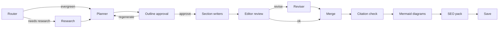

# AgentWriter-AI

AgentWriter-AI turns a single topic prompt into a researched, reviewed, publish-ready technical article. It is a multi-agent LangGraph pipeline with a FastAPI web UI that streams every step live.

## ✨ Features

- **Router** decides whether the topic is evergreen, needs some fresh examples, or is news, and how recent sources must be
- **Research agent** runs Tavily searches in parallel, filters by recency (`day`/`week`/`month`/`year`) and keeps only real URLs returned by search
- **Planner** builds an outline that follows your chosen **audience, tone and length**
- **Human-in-the-loop outline approval**: edit, reorder, add or remove sections, or send feedback and regenerate before any writing starts
- **Parallel section writers** that know the full outline, so they don't repeat each other
- **Editor / review agent** checks every section (coverage, duplication, citations, code, tone, length) and sends weak sections back for revision
- **Citation verification** removes any link that doesn't point at a researched source
- **Mermaid diagram agent** adds up to 3 architecture/flow/sequence diagrams, rendered in the UI
- **SEO & publishing pack**: SEO title, meta description, slug, keywords, tags, TL;DR and a social post
- **Configurable LLM provider**: Groq by default (`openai/gpt-oss-120b`), or Ollama / Google Gemini, with retries
- **PostgreSQL checkpointing** with a connection pool, falling back to in-memory checkpoints when no database is available

## 🏗️ Architecture



- `backend.py`: the LangGraph workflow: schemas, agents, graph and checkpointer
- `app.py`: FastAPI server that serves the UI, streams progress over Server-Sent Events and resumes runs after outline approval
- `templates/`, `static/`: the web UI (Mermaid diagrams are rendered client-side)
- `notebooks/4_blog_agent_with_image_gen.ipynb`: the original experiment notebook

## 🚀 Quick Start

### 1. Clone the repository

```bash
git clone https://github.com/Aayushg0908/AGENTI-AI-BLOG-WRITER.git
cd AGENTI-AI-BLOG-WRITER
```

### 2. Create and activate a virtual environment

```bash
python -m venv .venv
source .venv/bin/activate
```

On Windows PowerShell:

```powershell
python -m venv .venv
.\.venv\Scripts\Activate.ps1
```

### 3. Install dependencies

```bash
pip install -r requirements.txt
```

### 4. Configure environment variables

Create a `.env` file in the project root:

```env
# LLM: groq (default), ollama or google
LLM_PROVIDER=groq
LLM_MODEL=openai/gpt-oss-120b
GROQ_API_KEY=your_groq_key
# GOOGLE_API_KEY=your_google_ai_key
# OLLAMA_BASE_URL=http://localhost:11434
# OLLAMA_NUM_CTX=16384

# Research
TAVILY_API_KEY=your_tavily_key

# Optional: persistent checkpoints (in-memory if unset)
DATABASE_URL=postgresql://<user>:<password>@<host>:<port>/<db>

# Optional tuning
# LLM_RETRIES=3
# MAX_REVIEW_ROUNDS=1
# DB_POOL_SIZE=10
```

| Variable | Purpose |
|---|---|
| `LLM_PROVIDER` / `LLM_MODEL` | Which model to use. Defaults: `groq` + `openai/gpt-oss-120b`, `ollama` + `mistral`, `google` + `gemini-2.5-flash` |
| `GROQ_API_KEY` | Required for the default Groq provider |
| `OLLAMA_NUM_CTX` | Only for Ollama: context window. Keep it large; the default silently truncates long prompts |
| `TAVILY_API_KEY` | Web research |
| `DATABASE_URL` | Postgres checkpoints. `sslmode=require` is added for remote hosts |
| `MAX_REVIEW_ROUNDS` | Editor → revise cycles (0 disables revisions) |

### 5. Run the app

```bash
uvicorn app:app --reload
```

Open http://127.0.0.1:8000, enter a topic, pick audience/tone/length, and approve the outline when it appears.

## 📁 Project Structure

```text
.
├── app.py                 # FastAPI server, SSE streaming, resume endpoint
├── backend.py             # LangGraph agents and graph
├── requirements.txt
├── static/                # CSS/JS frontend assets
├── templates/             # Jinja HTML template
├── notebooks/             # Experiment notebook + sample outputs
├── docs/                  # Project documentation
└── outputs/<run_id>/      # Generated blog.md + meta.json (SEO, review, sources)
```

## 🔌 API

| Method | Path | Description |
|---|---|---|
| `POST` | `/api/run` | Start a run: `{topic, audience?, tone?, length: short\|medium\|long, require_approval}`. Streams events |
| `POST` | `/api/runs/{run_id}/resume` | Approve (optionally with an edited plan) or regenerate with feedback: `{action: "approve"\|"regenerate", plan?, feedback?}` |
| `GET` | `/api/runs/{run_id}/download` | Download the article as `<slug>.md` |
| `GET` | `/api/health` | Server status, active LLM and checkpointer type |

## 📄 License

This project is licensed under the MIT License. See the [LICENSE](LICENSE) file for details.

## 🙌 Acknowledgements

Originally based on [entbappy/AgentWriter-AI](https://github.com/entbappy/AgentWriter-AI). Built with LangGraph, LangChain, FastAPI, Tavily, Mermaid, Ollama, Groq and PostgreSQL.
