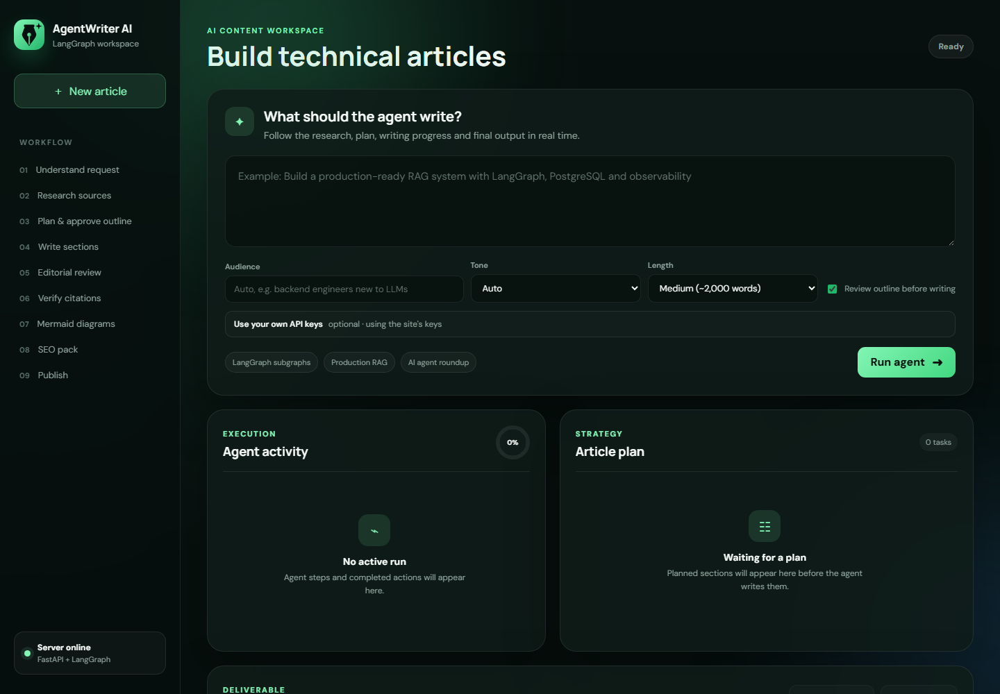
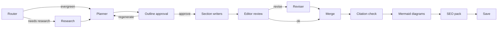

<p align="center">
  
</p>

<h1 align="center">AgentWriter-AI</h1>

AgentWriter-AI turns a single topic prompt into a researched, reviewed, publish-ready technical article. It is a multi-agent LangGraph pipeline with a FastAPI web UI that streams every step live.

**🔗 Live demo:** https://agentwriter-ai-uxry.onrender.com  (free tier — the first load can take ~30–60 s while the server wakes up)
**📝 Sample published post:** https://aayushg0908.github.io/posts/human-in-the-loop-langgraph-interrupts/



## ✨ Features

- **Router** decides whether the topic is evergreen, needs some fresh examples, or is news, and how recent sources must be
- **Research agent** runs Tavily searches in parallel, filters by recency (`day`/`week`/`month`/`year`) and keeps only real URLs returned by search
- **Planner** builds an outline that follows your chosen **audience, tone and length**
- **Human-in-the-loop outline approval**: edit, reorder, add or remove sections, or send feedback and regenerate before any writing starts
- **Parallel section writers** that know the full outline, so they don't repeat each other
- **Editor / review agent** checks every section (coverage, duplication, citations, code, tone, length) and sends weak sections back for revision
- **Citation verification** removes any link that doesn't point at a researched source
- **Mermaid diagram agent** adds up to 3 architecture/flow/sequence diagrams, rendered in the UI
- **SEO & publishing pack**: SEO title, meta description, slug, keywords, tags, TL;DR and a social post
- **Configurable LLM provider**: Groq by default (`openai/gpt-oss-120b`), or Ollama / Google Gemini, with retries
- **PostgreSQL checkpointing** with a connection pool, falling back to in-memory checkpoints when no database is available

## 🏗️ Architecture



- `backend.py`: the LangGraph workflow: schemas, agents, graph and checkpointer
- `app.py`: FastAPI server that serves the UI, streams progress over Server-Sent Events and resumes runs after outline approval
- `templates/`, `static/`: the web UI (Mermaid diagrams are rendered client-side)
- `notebooks/4_blog_agent_with_image_gen.ipynb`: the original experiment notebook

## 🚀 Quick Start

### 1. Clone the repository

```bash
git clone https://github.com/Aayushg0908/AGENTI-AI-BLOG-WRITER.git
cd AGENTI-AI-BLOG-WRITER
```

### 2. Create and activate a virtual environment

```bash
python -m venv .venv
source .venv/bin/activate
```

On Windows PowerShell:

```powershell
python -m venv .venv
.\.venv\Scripts\Activate.ps1
```

### 3. Install dependencies

```bash
pip install -r requirements.txt
```

### 4. Configure environment variables

Create a `.env` file in the project root:

```env
# LLM: groq (default), ollama or google
LLM_PROVIDER=groq
LLM_MODEL=openai/gpt-oss-120b
GROQ_API_KEY=your_groq_key
# GOOGLE_API_KEY=your_google_ai_key
# OLLAMA_BASE_URL=http://localhost:11434
# OLLAMA_NUM_CTX=16384

# Research
TAVILY_API_KEY=your_tavily_key

# Optional: persistent checkpoints (in-memory if unset)
DATABASE_URL=postgresql://<user>:<password>@<host>:<port>/<db>

# Optional tuning
# LLM_RETRIES=3
# MAX_REVIEW_ROUNDS=1
# DB_POOL_SIZE=10
```

| Variable | Purpose |
|---|---|
| `LLM_PROVIDER` / `LLM_MODEL` | Which model to use. Defaults: `groq` + `openai/gpt-oss-120b`, `ollama` + `mistral`, `google` + `gemini-2.5-flash` |
| `GROQ_API_KEY` | Required for the default Groq provider |
| `OLLAMA_NUM_CTX` | Only for Ollama: context window. Keep it large; the default silently truncates long prompts |
| `TAVILY_API_KEY` | Web research |
| `DATABASE_URL` | Postgres checkpoints. `sslmode=require` is added for remote hosts |
| `MAX_REVIEW_ROUNDS` | Editor → revise cycles (0 disables revisions) |

### 5. Run the app

```bash
uvicorn app:app --reload
```

Open http://127.0.0.1:8000, enter a topic, pick audience/tone/length, and approve the outline when it appears.

## 📣 Publishing (GitHub Pages + dev.to)

After an article is finished, the **Publish** card lets each user publish to **their own** accounts:

1. **GitHub Pages** goes first. The article is committed to `_posts/YYYY-MM-DD-<slug>.md` (or `_drafts/`) in the user's Pages repo and served at `/posts/<slug>/`, with Mermaid rendered in the browser. Start a site from [`github-pages-starter/`](github-pages-starter/).
2. **dev.to** follows, using the GitHub Pages URL as its canonical URL. Mermaid diagrams are converted to images.

For each platform the user picks an account:

- **My own account:** the user enters their GitHub repo + fine-grained token (*Contents: Read and write* on that repo only) and/or their dev.to API key. Credentials are sent only with the publish request and never stored on the server. "Remember on this device" keeps them in that user's browser.
- **Default account:** publishes to the site owner's blog / dev.to, configured on the server. It's offered only when configured, and requires `PUBLISH_PASSWORD`, so strangers can't post to the owner's accounts. Tokens are never sent to the browser.

| Variable (server) | Purpose |
|---|---|
| `PUBLISH_PASSWORD` | Required for the default account. Without it, only "my own account" is offered |
| `DEFAULT_GITHUB_TOKEN` / `DEFAULT_GITHUB_REPO` | Owner's fine-grained token and `owner/owner.github.io` |
| `DEFAULT_GITHUB_BRANCH` / `DEFAULT_GITHUB_BASE_URL` | Optional (default `main`; base URL only for custom domains) |
| `DEFAULT_DEVTO_API_KEY` | Owner's dev.to API key |

Re-publishing an article doesn't create duplicates: a draft is promoted in place.

## 🔑 Bring your own API keys

The composer has an optional **"Use your own API keys"** section. A user can paste their own **Groq** and **Tavily** keys; empty fields fall back to the server's `GROQ_API_KEY` / `TAVILY_API_KEY`. User keys are held in memory only for the duration of that run, never written to checkpoints, the database or output files, and can optionally be remembered in the user's own browser.

## 📁 Project Structure

```text
.
├── app.py                 # FastAPI server, SSE streaming, resume endpoint
├── backend.py             # LangGraph agents and graph
├── publishers.py          # GitHub Pages + dev.to publishing
├── github-pages-starter/  # Jekyll site to copy into your Pages repo
├── requirements.txt
├── static/                # CSS/JS frontend assets
├── templates/             # Jinja HTML template
├── notebooks/             # Experiment notebook + sample outputs
├── docs/                  # Project documentation
└── outputs/<run_id>/      # Generated blog.md + meta.json (SEO, review, sources)
```

## 🔌 API

| Method | Path | Description |
|---|---|---|
| `POST` | `/api/run` | Start a run: `{topic, audience?, tone?, length: short\|medium\|long, require_approval, groq_api_key?, tavily_api_key?}`. Streams events |
| `POST` | `/api/runs/{run_id}/resume` | Approve (optionally with an edited plan) or regenerate with feedback: `{action: "approve"\|"regenerate", plan?, feedback?}` |
| `GET` | `/api/runs/{run_id}/download` | Download the article as `<slug>.md` |
| `GET` | `/api/publishers` | Which default accounts are available (no secrets) |
| `POST` | `/api/runs/{run_id}/publish` | `{platforms, mode: "draft"\|"publish", github?: {use_default} \| {repo, token, branch?, base_url?}, devto?: {use_default} \| {api_key}}`; header `X-Publish-Password` when using a default account |
| `GET` | `/api/health` | Server status, active LLM and checkpointer type |

## 📄 License

This project is licensed under the MIT License. See the [LICENSE](LICENSE) file for details.

## 🙌 Acknowledgements

Originally based on [entbappy/AgentWriter-AI](https://github.com/entbappy/AgentWriter-AI). Built with LangGraph, LangChain, FastAPI, Tavily, Mermaid, Ollama, Groq and PostgreSQL.
